# Навіщо це потрібно

**Застосунок для Google Sheets** — бічна панель HR Admin усередині
звичайної Google-таблиці. Вона переносить дані системи в таблицю, дає
змінити їх у звичному інструменті й повертає зміни в систему — **лише
після перевірки й підтвердження**.

## Для чого він

| Завдання | Як це виглядало без застосунку | Як це виглядає з ним |
|---|---|---|
| Змінити посади або дати багатьом людям | Відкривати кожну особову справу окремо | Змінити рядки в одній вкладці, перевірити й виконати разом |
| Звірити облік із реальністю | Вивантажувати звіти, порівнювати вручну | Таблиця показує, чим рядок відрізняється від системи |
| Підготувати списки для командира чи кадрового органу | Копіювати дані вручну | Експорт за підрозділом за кілька секунд, з фільтрами й формулами Google |
| Додати нові записи (знання мов, контакти, звання…) | Форма за формою | Рядок за рядком у таблиці або через форму в панелі |
| Роздрукувати картку особи | Збирати дані з кількох вкладок | Кнопка «Картка» будує друковану вкладку |

## Головні принципи

- **Система — джерело правди, таблиця — робочий вигляд.** Дані в
  таблиці не змінюють систему, доки ви не перевірите їх і не натиснете
  «Виконати».
- **Спершу перегляд, потім зміни.** Перевірка показує, що саме
  зміниться, які рядки мають помилки й чому; кожен рядок отримує позначку
  в стовпці «Статус».
- **Ті самі правила, що й у застосунку.** Обов'язкові поля, формати,
  списки значень, права доступу — усе як у формах системи.
- **Кадрові зміни — тільки наказами.** Нове призначення чи переміщення з
  таблиці стає **проєктом наказу**, який проходить звичайний маршрут
  погодження й підпису.
- **Ви бачите лише своє.** Таблиця містить тільки тих людей і ті записи,
  які вам дозволено бачити; кожен перегляд чутливих даних фіксується в
  журналі доступу.

# Початок роботи

## Що потрібно

- Обліковий запис у HR Admin (вхід через Google) з тією самою адресою,
  що й у Google Sheets: один раз увійдіть у застосунок у браузері.
- Таблиця, до якої підключено скрипт застосунку (налаштовує
  адміністратор). У меню таблиці з'являється пункт **App**.

## Як відкрити панель

1. Відкрийте таблицю.
2. Меню **App → Open panel**.
3. Праворуч відкриється бічна панель; зелена крапка вгорі означає, що
   з'єднання з системою встановлено.

> Якщо браузер увійшов одразу в кілька облікових записів Google,
> скрипт може не запуститися. Відкрийте таблицю у вікні, де увійшов
> лише потрібний обліковий запис (окремий профіль Chrome або вікно
> інкогніто). Після оновлення застосунку закрийте й знову відкрийте
> панель.

# Бічна панель

## Верхній рядок

Угорі завжди є лише найнеобхідніше:

| Елемент | Призначення |
|---|---|
| ● | Стан з'єднання (зелений — підключено) |
| ☰ | Меню: обліковий запис, «Формат аркуша», «Вигляд бічної панелі» (для адміністратора), «Відкрити застосунок», а внизу — тема й мова |
| ⤒ | **Експорт** вибраних даних у таблицю |
| ⤓ | **Перевірити** зміни в таблиці |
| + | **Новий рядок** — порожня форма для нової особи чи запису |
| 🔍 | **Знайти людину** |
| Аватар | Ваш обліковий запис |

Значки інструментів залежать від відкритої вкладки й ваших прав: хто
лише переглядає, не бачить «Перевірити» і «Новий рядок».

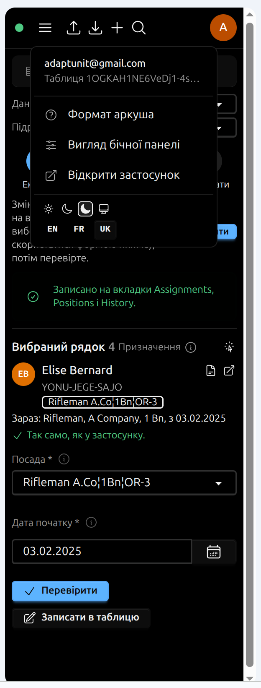{width=34%}

**Тема й мова** — у нижній частині меню: ряд значків теми (світла,
темна, чорна, як на пристрої) і ряд мов (EN, FR, UK). Підказка з'являється
при наведенні; поточний вибір позначено.

## Вкладки «Аркуш» і «Дані»

- **Аркуш** — простий перегляд діапазону поточного аркуша.
- **Дані** — основна робота: вибір даних, кроки, перевірка, форма
  вибраного рядка.

# Які дані можна відкрити

У вкладці **Дані** поле **«Дані»** визначає, з чим ви працюєте:

| Дані | Що у вкладці таблиці | Що змінюється в системі |
|---|---|---|
| **Призначення** | Одна людина — один рядок: підрозділ, посада, дата початку | Проєкти наказів про призначення, переміщення, звільнення; виправлення дати початку |
| **Люди** | Ім'я, по батькові, прізвище, e-mail, дата й країна народження | Дані особи; нові особи |
| **Види записів** (звання, контакти, знання мов, сімейний стан, відпустки, відрядження, допуски…) | Один запис — один рядок | Записи особової справи; нові записи |

Список видів записів залежить від ваших прав: медичні записи бачить лише
медичний персонал тощо.

**Підрозділ** — щоб експортувати лише людей одного підрозділу (і
підпорядкованих йому), оберіть його в полі **«Підрозділ»**. За
замовчуванням це ваш власний підрозділ. Вкладка запам'ятовує свій
підрозділ: наступний експорт буде для того самого.

# Як влаштована вкладка

Кожен вид даних отримує власну вкладку (Assignments, People, Language
skills, Leave…), оформлену як форма застосунку:

| Що бачите | Що це означає |
|---|---|
| Темний рядок заголовків | Назви полів вашою мовою; наведіть на заголовок, щоб побачити підказку |
| Сірий текст | Лише для читання (PersonID, ім'я, підрозділ); зміна викликає попередження |
| Список зі стрілкою | Вибір зі значень, як у формі (посади, види відпусток…) |
| Прапорець | Так / ні |
| Дата | Справжня дата; подвійне клацання відкриває календар |
| **Бурштинова** клітинка | Ви змінили значення після експорту |
| **Червона** клітинка | Значення стерто, або порожнє обов'язкове поле |
| Дужка над стовпцями | Поля, які у формі стоять поруч (наприклад, перший і останній день); можна згорнути |
| Стовпець **«Статус»** | Результат перевірки й виконання для кожного рядка |

Перший рядок (службові ключі) і кілька службових стовпців праворуч
приховані — не відкривайте й не змінюйте їх: за ними система розпізнає
вкладку й помічає зміни.

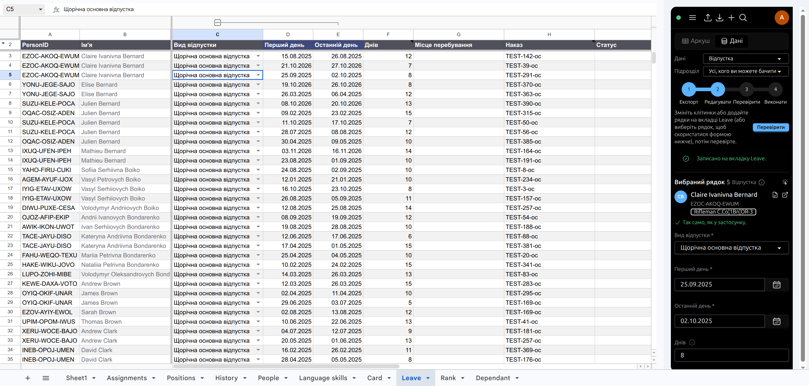

## Стовпець «Статус»

| Позначка | Колір | Значення |
|---|---|---|
| **→** | синій | Буде виконано (після перевірки) |
| **✓** | зелений | Виконано |
| **!** | бурштиновий | Потребує уваги: рядок змінено ще й у системі; або пропущено, бо вже є відкритий наказ |
| **↻** | бурштиновий | Рядок застарів — у системі його змінили після експорту; експортуйте знову |
| **✗** | червоний | Не виконано — причина поруч (невідомий PersonID, недопустиме значення…) |

# Порядок роботи: чотири кроки

Над формою — покрокова підказка **Експорт → Редагувати → Перевірити →
Виконати**; поточний крок підсвічено, поруч — кнопка наступної дії.

## Крок 1. Експорт

Оберіть **Дані** (наприклад, «Призначення») і **Підрозділ**, натисніть
**Експорт**. Система запише вкладку (для призначень — ще й довідкові
вкладки Positions і History).

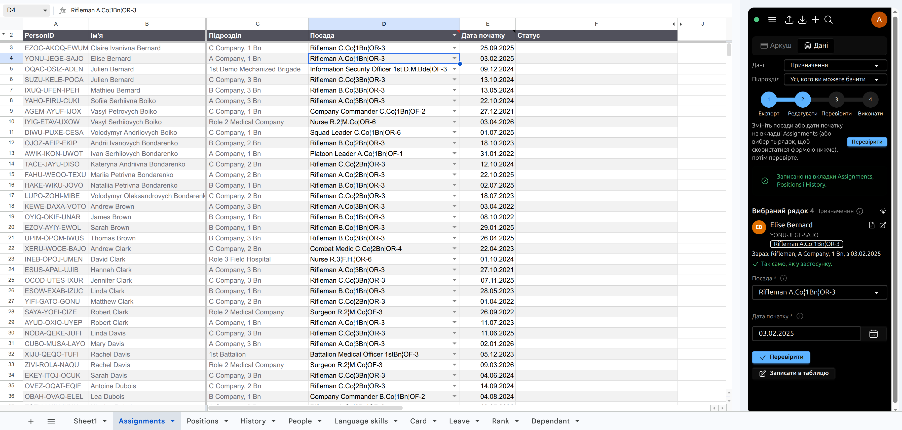

## Крок 2. Редагування

Змінюйте клітинки в таблиці — або виберіть рядок і змініть його у
**формі вибраного рядка** в панелі, потім **«Записати в таблицю»**.
Змінені клітинки стають бурштиновими.

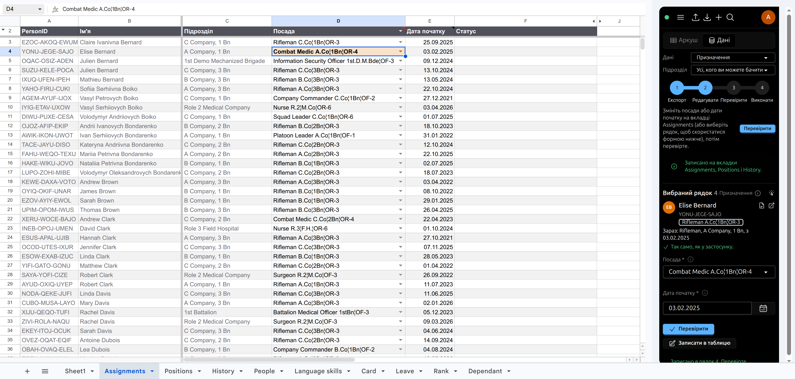

## Крок 3. Перевірка

Натисніть **Перевірити**. Система прочитає вкладку, звірить кожен рядок
із даними в системі й покаже **перегляд змін**: що буде зроблено, які
рядки пропущено й чому. Кожен рядок отримує позначку в стовпці
«Статус». **У системі поки що нічого не змінилося.**

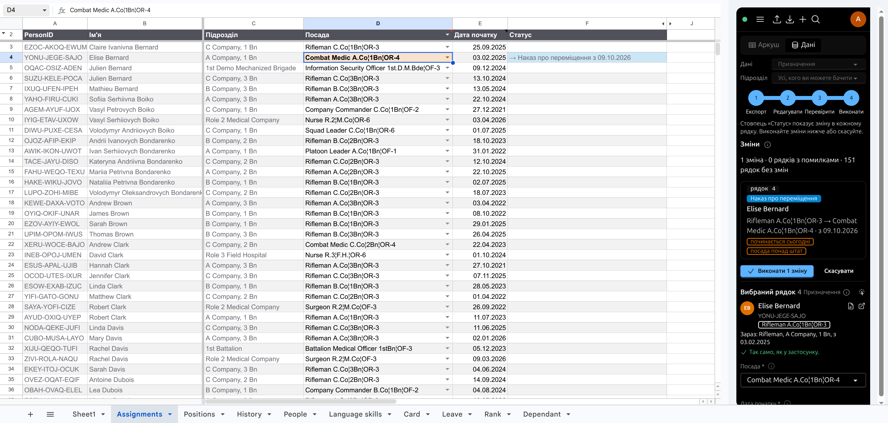

## Крок 4. Виконання

Натисніть **«Виконати N змін»**. Система:

- для **призначень** створює **проєкти наказів** (посади зміняться лише
  після підпису) і перезаписує вкладку з бази;
- для **людей і записів** зберігає зміни й перезаписує лише виконані
  рядки; рядки з помилками залишаються, як ви їх ввели, з причиною в
  «Статусі».

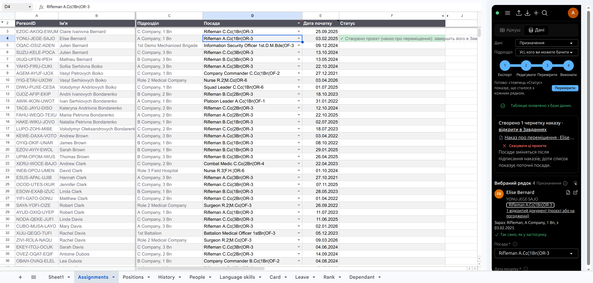

Під звітом — посилання на кожен створений проєкт наказу та кнопка
**«Скасувати ці проєкти»**: вона скасовує ті проєкти, які ще не
надіслано на погодження (наприклад, якщо зміни внесено помилково).

# Форма вибраного рядка

Виберіть будь-яку клітинку рядка на вкладці, яку записав застосунок, —
у панелі відкриється **форма цього рядка**, така сама, як у застосунку:

- **картка особи**: фото або ініціали, PersonID, посада, кількість
  відкритих документів; кнопки «Картка в таблиці» та «Відкрити в
  застосунку»;
- **порівняння з системою**: «Так само, як у застосунку», «Відрізняється
  від застосунку: …» або «рядок застарів»;
- поля форми з підказками, списками, повзунками й календарем;
- **«Перевірити»** — перевірити й виконати лише цей рядок;
- **«Записати в таблицю»** — перенести значення форми в клітинки рядка
  (для спільного виконання пізніше).

Вид даних визначається самою вкладкою, тож поле «Дані» перемикається
автоматично, коли ви переходите на іншу вкладку. Якщо хтось змінить
вибраний рядок у таблиці, форма оновиться сама за кілька секунд.

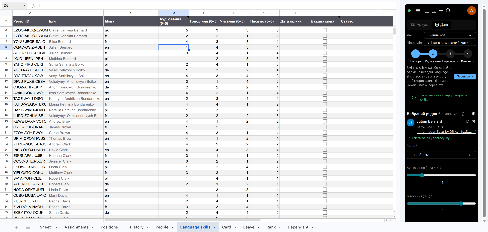

# Нові рядки та PersonID

Значок **+** відкриває порожню форму для вибраних даних (людей або
записів):

- **«Зберегти в застосунку»** — одразу створює особу чи запис і додає
  рядок у таблицю;
- **«Додати в таблицю»** — лише додає рядок; збережеться під час
  наступної перевірки.

**PersonID нової особи** генерується заздалегідь і показується у формі.
Якщо ідентифікатор не подобається (наприклад, неблагозвучне поєднання
букв), натисніть **↻** — з'явиться інший. Особа буде збережена саме з
тим PersonID, який ви бачите.

Новий рядок можна додати й просто в таблиці:

- для **нової особи** залиште PersonID порожнім — система згенерує його
  під час перевірки й покаже в «Статусі»; або виберіть рядок і натисніть
  **«Згенерувати»** / **↻** у панелі;
- для **нового запису** вкажіть PersonID особи, якої він стосується.

Ідентифікатор не можна вигадати довільно: система приймає лише
PersonID, який вона сама згенерувала, і перевіряє, що він ще вільний.

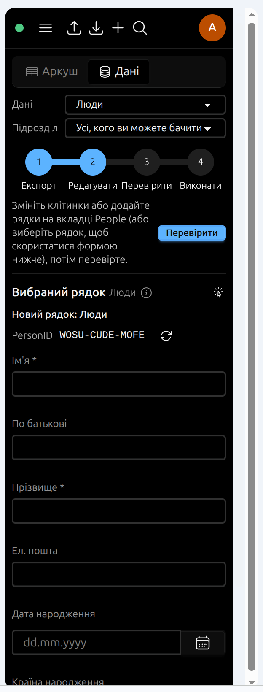{width=34%}

# Знайти людину

Значок **🔍** відкриває пошук за іменем, e-mail або PersonID. Клацання
по результату виділяє рядок цієї людини на відкритій вкладці й відкриває
його форму; значок поруч відкриває особову справу в застосунку. Якщо
людини немає на вкладці (інший підрозділ або вкладку ще не
експортовано), панель про це скаже.

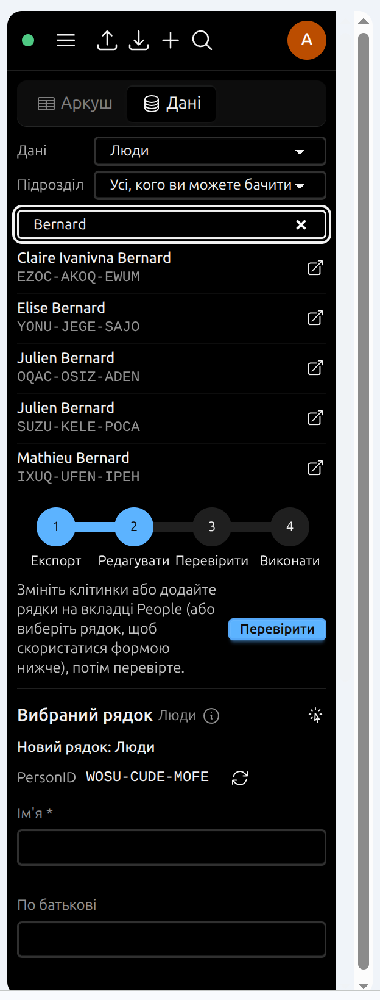{width=34%}

# Картка особи

Кнопка **«Картка в таблиці»** у картці особи будує вкладку **Card**:
ім'я, PersonID, поточна посада, а далі — усі записи, які вам дозволено
бачити, за видами й від нових до старих. Вкладка оформлена для друку
(без сітки, із заголовками розділів). Це лише перегляд — зміни на ній
не імпортуються.

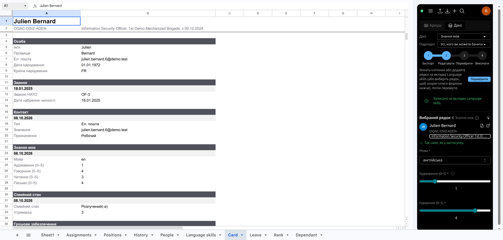

# Налаштування для адміністратора

Сторінка **Адміністрування → Вигляд бічної панелі** в застосунку
визначає, що бачать у панелі різні **ролі** та **профілі доступу**:
вкладки, значки інструментів, покрокову підказку, форму вибраного рядка.
Користувач не бачить елемента, з якого знято позначку для його ролі або
хоча б одного з його профілів. Елементи, що потребують дозволу, бачать
лише ті, хто його має, — незалежно від позначок. Зміни видно після
повторного відкриття панелі.

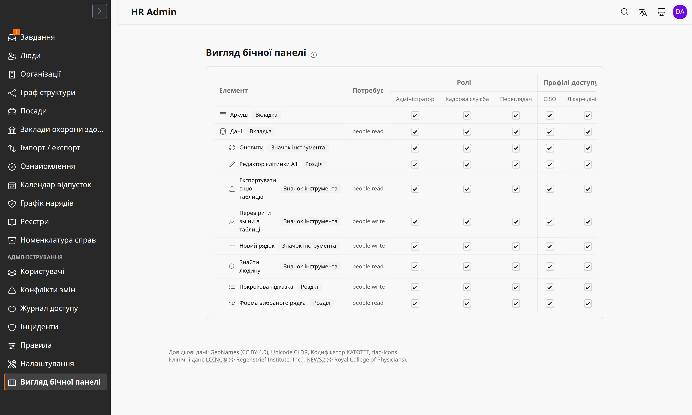

# Безпека й обмеження

- Таблиця — копія для роботи. Не зберігайте в ній чутливі дані довше,
  ніж потрібно, і не надавайте до неї доступ стороннім: доступ до
  таблиці керується Google, а не системою.
- Перевірка й виконання завжди йдуть від вашого імені й з вашими
  правами: без права на зміну ви можете експортувати, але не виконати.
- Якщо після експорту хтось змінив дані в системі, ваш незмінений рядок
  не «відкотить» їх: він позначається **↻ застарів**. Якщо ви змінили
  рядок, а його змінили й у системі, — **! конфлікт**; виконання
  перезапише значення, а конфлікт буде зафіксовано.
- Видалення рядка з таблиці нічого не видаляє в системі.
- Google обмежує кількість звернень до таблиці за хвилину: для великих
  обсягів експортуйте окремий підрозділ.

# Поширені питання

**Панель показує помилку входу.** Закрийте й знову відкрийте панель
(App → Open panel). Якщо браузер увійшов у кілька облікових записів
Google — відкрийте таблицю у вікні з одним обліковим записом.

**«Немає облікового запису…».** Увійдіть один раз у застосунок HR Admin
у браузері з тією самою адресою Google.

**«У цій таблиці немає вкладки …».** Спершу виконайте експорт цих
даних. Назви вкладок англійською (Assignments, People, Leave…) — не
перейменовуйте їх.

**Чому посада не змінилася після «Виконати»?** Призначення змінюються
лише підписаним наказом. Проєкт наказу — у розділі **Завдання**
застосунку; доки його не підписано, таблиця показує поточну посаду.

**Як скасувати помилкове виконання?** Для призначень — «Скасувати ці
проєкти» під звітом (доки проєкти не надіслано на погодження). Для
людей і записів — змініть значення назад і виконайте ще раз.

**Чому рядок позначено ↻?** Хтось змінив ці дані в системі після вашого
експорту. Експортуйте вкладку знову й повторіть зміну.
