# Про систему

**HR Admin** — система кадрового та медичного обліку з електронним
документообігом. Вона веде особові справи людей (посади, історію
призначень, підпорядкування, медичні та інші записи) і проводить
документи — рапорти, накази, довідки, медичні висновки — від проєкту до
підпису та виконання.

Система працює у браузері на комп'ютері й телефоні, а також у бічній
панелі Google Sheets. Інтерфейс доступний англійською, українською та
французькою мовами.

## Ключові можливості

| Можливість | Що це дає |
|---|---|
| **Особова справа** | Посада, підрозділ, підпорядкування, документи, ідентифікатори, записи (звання, відпустки, допуски, медичні дані), файли, хронологія — на одній сторінці. |
| **Документи з маршрутом** | Рапорт або наказ створюється як проєкт, проходить погодження й підпис за маршрутом, отримує номер у реєстрі та PDF, після підпису не змінюється. |
| **Наслідки підпису** | Підписаний наказ сам змінює дані: призначає на посаду, записує відпустку чи відрядження, оновлює придатність після висновку ВЛК. |
| **Стартова сторінка «Чекає на вас»** | Кожен користувач починає з власних завдань: що погодити, підписати, з чим ознайомитися; прострочене позначено. |
| **Самообслуговування** | Особа сама подає рапорти (відпустка, відрядження) та запити на довідки й стежить за ними. |
| **Ознайомлення з наказами** | Особа підтверджує ознайомлення в застосунку, або кадровий орган чи командир записує його за неї — поодинці чи списком. |
| **Календар відпусток** | Хто з підрозділу відсутній і коли; дні, коли відсутніх забагато або відсутні кілька керівників. |
| **Медичний модуль** | Життєві показники з оцінкою NEWS2, алергії, препарати, процедури, направлення, виписки, ВЛК. |
| **Захист даних** | Доступ за ролями та підрозділами, шифрування чутливих даних, журнал кожного перегляду чутливої інформації, екстрений доступ із подальшою перевіркою. |
| **Узгодженість даних** | Правила перевіряють записи й документи під час збереження; порушення стають інцидентами для перевірки. |
| **Структура й наряди** | Інтерактивний граф підрозділів, посад і людей; місячний графік нарядів із перевіркою відпочинку та відсутностей. |
| **Google Sheets** | Масове редагування призначень, особового складу й записів у звичній таблиці — з перевіркою й переглядом змін перед збереженням (окремий посібник). |
| **Обмін даними** | Імпорт і експорт призначень через Excel (.xlsx) або Google Sheets; програмний доступ за стандартом HL7 FHIR R5. |

## Що нового (жовтень 2026)

- **Граф структури** — уся організація як інтерактивна схема (розділ
  «Командир»).
- **Графік нарядів** і **календар відпусток** підвантажують рядки під час
  прокручування — швидко навіть для великих підрозділів.
- **Результати аналізів** з референтними діапазонами й попереднім
  значенням (розділ «Медичний персонал»).
- **Звіт про відрядження** з розрахунком добових; накази на бланку з
  реєстраційною позначкою; акт про знищення справ.
- **Бічна панель Google Sheets** повністю оновлена: вкладки, побудовані
  як форми застосунку, стовпець «Статус», форма вибраного рядка, пошук,
  картка особи — див. окремий посібник *«Застосунок для Google Sheets»*.

# Ролі та доступ

Доступ визначає **базова роль** і **профілі доступу**, які призначає
адміністратор. Профіль може діяти на всю організацію або лише на
підрозділ користувача та підпорядковані йому підрозділи. Користувач
бачить у меню лише ті розділи, до яких має доступ.

| Роль | Основні завдання | Головні екрани |
|---|---|---|
| **Особа** (військовослужбовець, працівник) | Подає рапорти й запити на довідки, ознайомлюється з наказами | Завдання |
| **Командир** | Погоджує рапорти, підписує накази, стежить за готовністю й відпустками підрозділу | Стартова сторінка, Календар відпусток, Ознайомлення |
| **Кадровий орган** | Веде особові справи, готує й погоджує накази, видає довідки, записує ознайомлення | Люди, Завдання, Імпорт / експорт, Ознайомлення |
| **Медичний персонал** (лікар, медсестра, бойовий медик, ВЛК) | Веде медичні записи, направлення, виписки, висновки ВЛК | Люди → Записи, Завдання |
| **Адміністратор** | Користувачі й доступ, системні налаштування, правила | Користувачі, Налаштування, Правила |
| **Безпека** (офіцер безпеки, CISO) | Контроль доступу до даних, інциденти, допуски | Журнал доступу, Інциденти |

# Як влаштовано документ

Кожен документ проходить однаковий шлях:

| Стан | Що відбувається |
|---|---|
| **Проєкт** | Автор заповнює поля, зберігає, обирає виконавців для кожного кроку маршруту й надсилає. |
| **На погодженні** | Кроки виконуються по черзі: хтось погоджує, хтось підписує. Будь-хто на маршруті може повернути документ на доопрацювання з коментарем. |
| **Підписано** | Документ отримує номер у реєстрі, PDF і контрольні суми (SHA-256); змінити його вже не можна. Виконуються наслідки підпису. |
| **Скасовано** | Проєкт скасовано автором; документ лишається в історії. |

**Терміни.** Крок погодження або підпису вважається простроченим, якщо
чекає довше, ніж задано в налаштуваннях (за замовчуванням — 3 дні).
Прострочене позначено червоним, термін, що спливає найближчими днями, —
помаранчевим.

# Особа: рапорт, ознайомлення, довідка

## Стартова сторінка

Після входу особа бачить блок **«Чекає на вас»**: тут накази для
ознайомлення та інші завдання. Нижче — розділи, доступні цій особі.

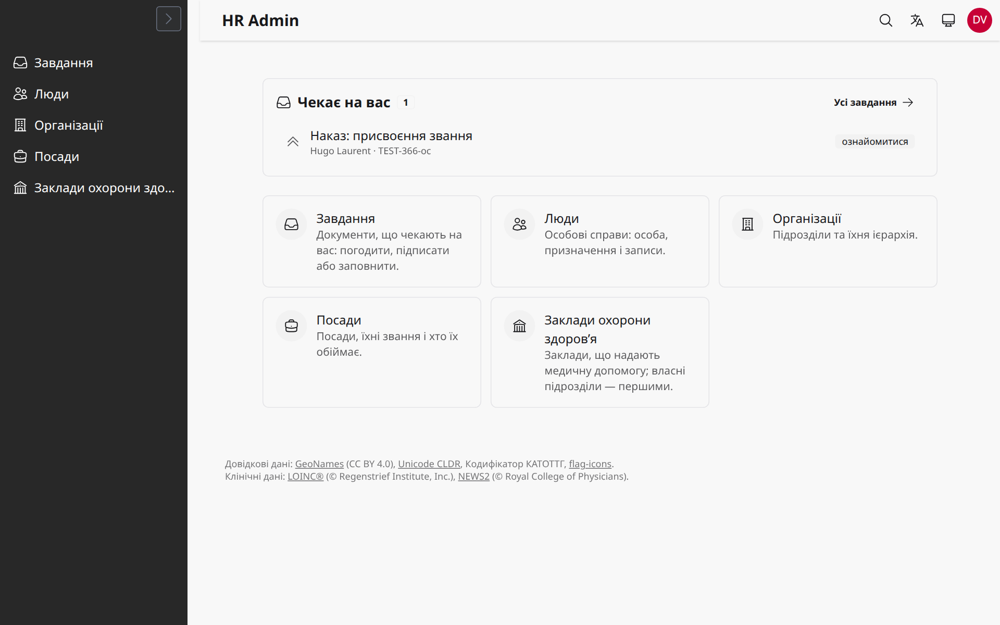

## Рапорт на відпустку — крок за кроком

1. Відкрийте **Завдання**, оберіть у списку «Рапорт на відпустку» і
   натисніть **«Нове звернення»**.

   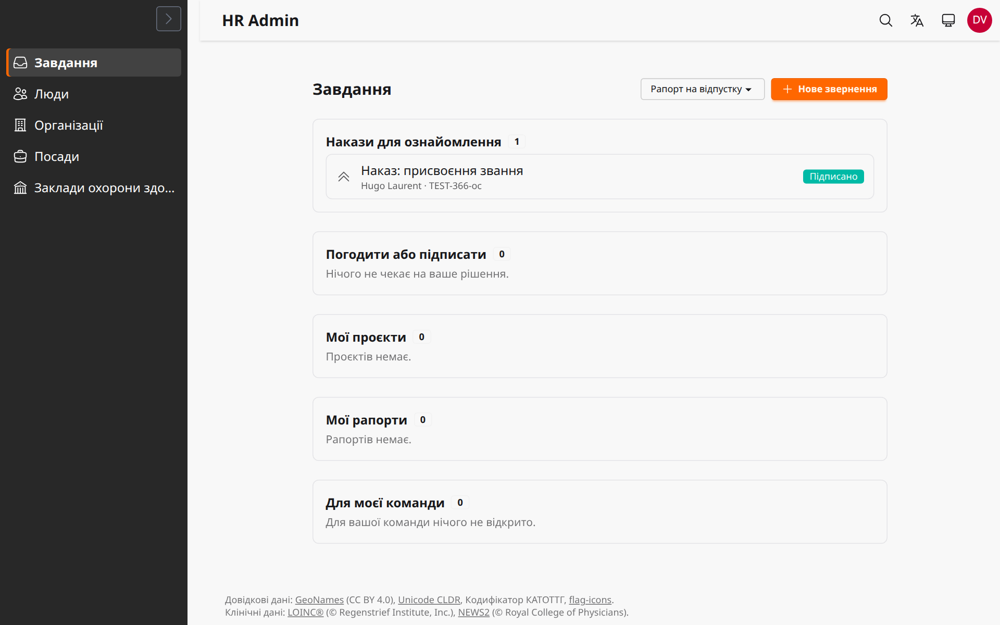

2. Заповніть вид відпустки, перший і останній день, місце перебування та
   зв'язок. Угорі система одразу показує, скільки днів запитано, скільки
   ще лишається цього року та скільки людей підрозділу буде відсутні
   одночасно. Натисніть **«Зберегти проєкт»**.

   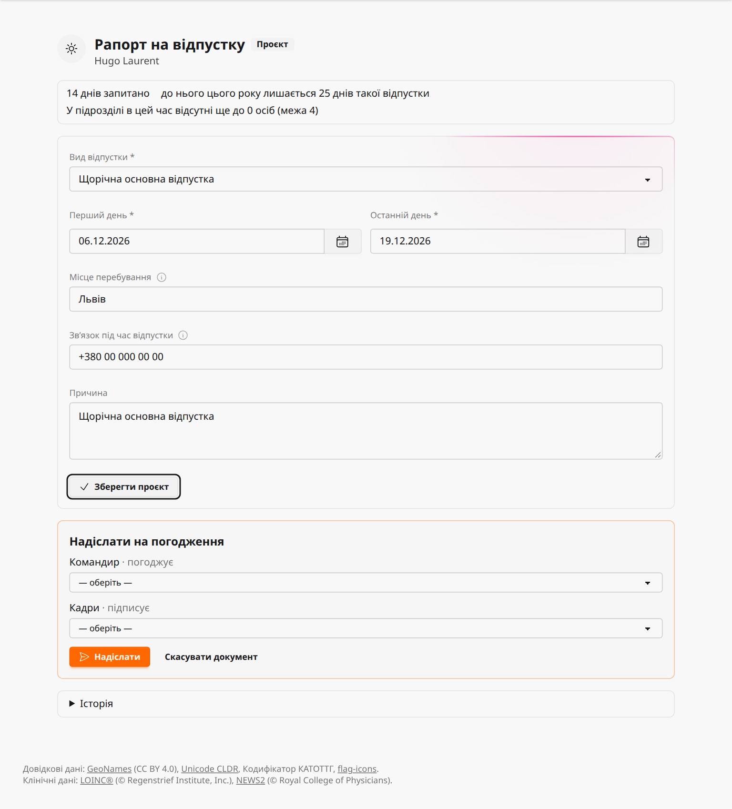

3. У блоці **«Надіслати на погодження»** оберіть командира, який погодить
   рапорт, і працівника кадрового органу, який його підпише. Натисніть
   **«Надіслати»**.

   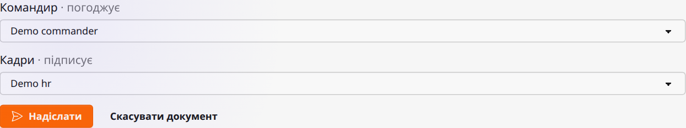

4. Рапорт отримує стан **«На погодженні»**; маршрут показує, на кому
   документ зараз. Рапорт видно в розділі «Мої рапорти» на сторінці
   Завдання.

   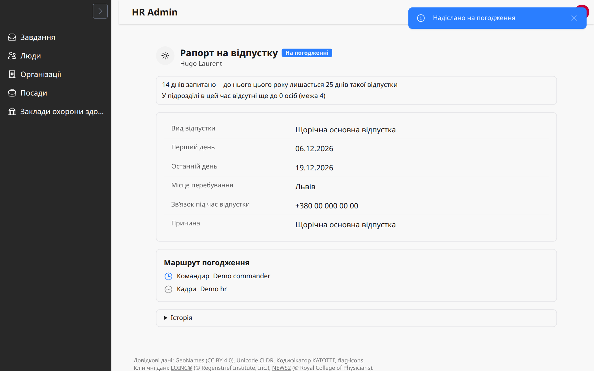

Так само подається **рапорт на відрядження**; після повернення особа
подає **звіт про відрядження** — система сама розраховує добові за
нормами й фіксує суми в момент підпису.

## Ознайомлення з наказом

Підписаний наказ щодо особи з'являється в блоці «Накази для
ознайомлення». Відкрийте його та натисніть **«З наказом ознайомлений»**.

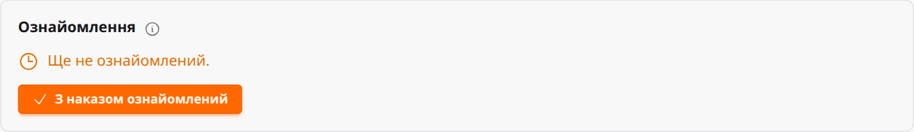

Система записує дату та спосіб ознайомлення; змінити запис не можна.

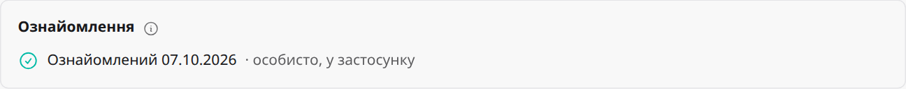

## Довідки

У тому ж списку на сторінці **Завдання** доступні довідки: з місця
служби, про грошове забезпечення, про склад сім'ї, про відпустки. У
проєкті довідки видно, що саме вона засвідчить на сьогодні; дані
фіксуються в момент підпису кадровим органом, після чого довідку можна
завантажити в PDF.

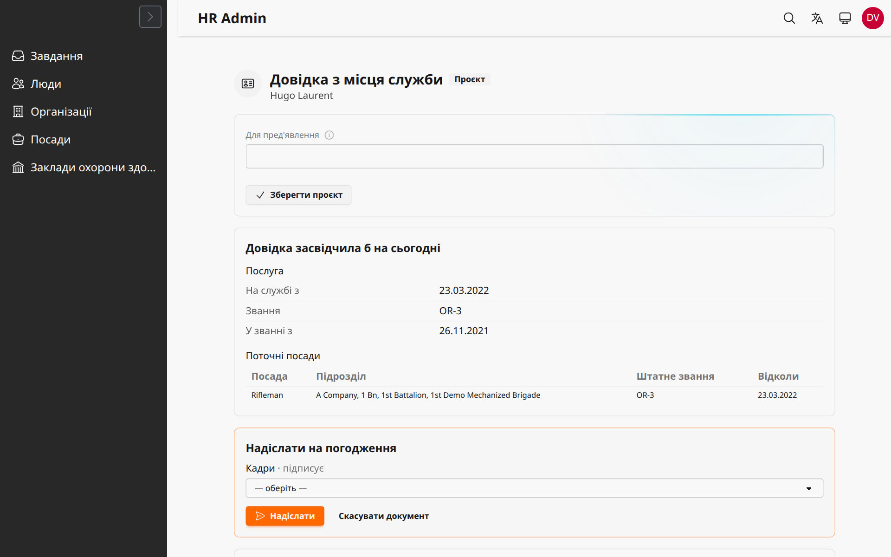

# Командир: погодження, підпис, підрозділ

## Стартова сторінка

Угорі — документи, що чекають рішення командира, найтерміновіші першими,
з позначкою «прострочено». Нижче — **готовність** підрозділу: скільки
людей придатні, обмежено придатні та непридатні.

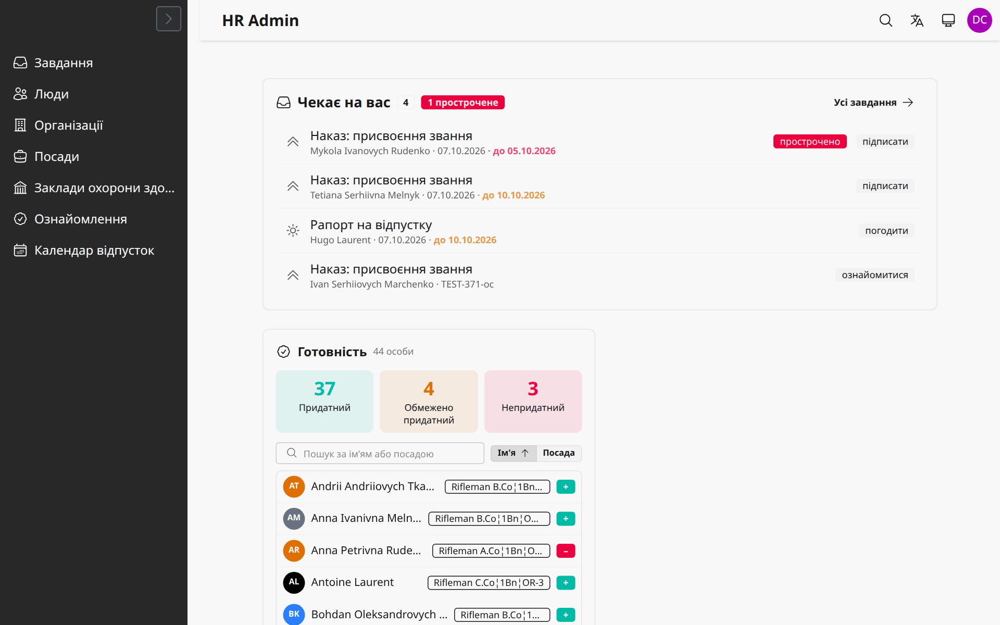

## Погодження рапорту

1. Відкрийте рапорт зі стартової сторінки.
2. Перевірте дані та навантаження на підрозділ (скільки людей відсутні в
   ці дні, яка межа).
3. За потреби додайте коментар і натисніть **«Схвалити»** або
   **«Повернути на доопрацювання»**.

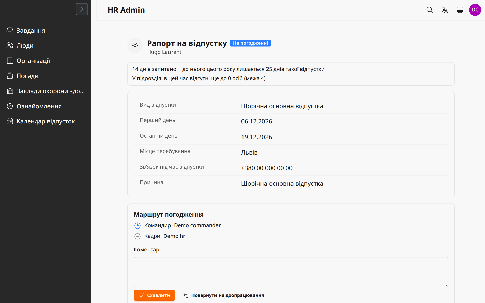

## Підпис наказу

Для наказу на кроці командира замість «Схвалити» є кнопка
**«Підписати»**. Після підпису наказ отримує номер, PDF і контрольні суми,
а система виконує його наслідки (наприклад, записує нове звання). Нижче
видно блок ознайомлення: його можна записати за особу.

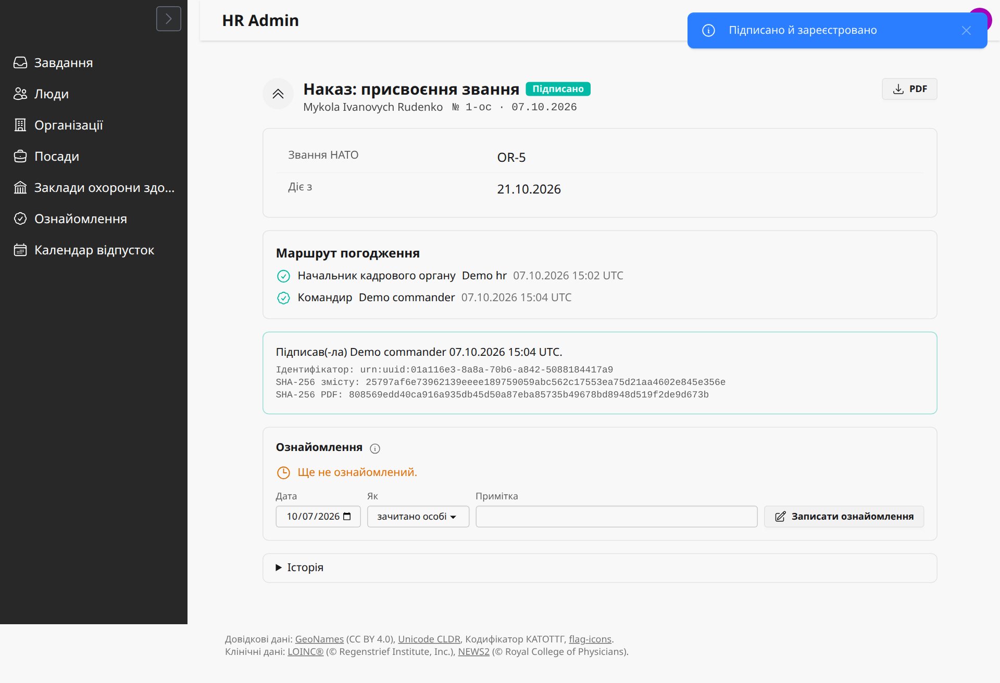

## Календар відпусток

Особовий склад підрозділу по днях місяця: відпустки (кольором за видом),
лікарняні, відрядження; запитані, але ще не підписані, — пунктиром.
Зірочкою позначено керівні посади. Система попереджає про конфлікти: у
певні дні відсутніх більше, ніж дозволяє межа, або відсутні кілька
керівників одночасно.

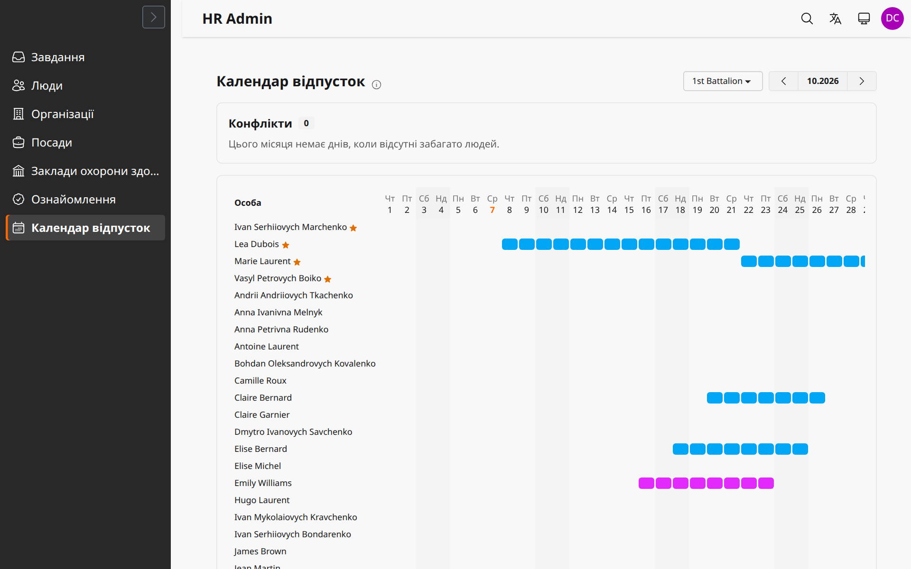

## Графік нарядів

Місячна сітка нарядів підрозділу: хто, коли й у якому наряді (черговий,
днювальний тощо). Система підсвічує наряд під час відпустки, лікарняного
чи відрядження та наряди без достатнього відпочинку; угорі — підсумок
таких порушень. Рядки підвантажуються під час прокручування.

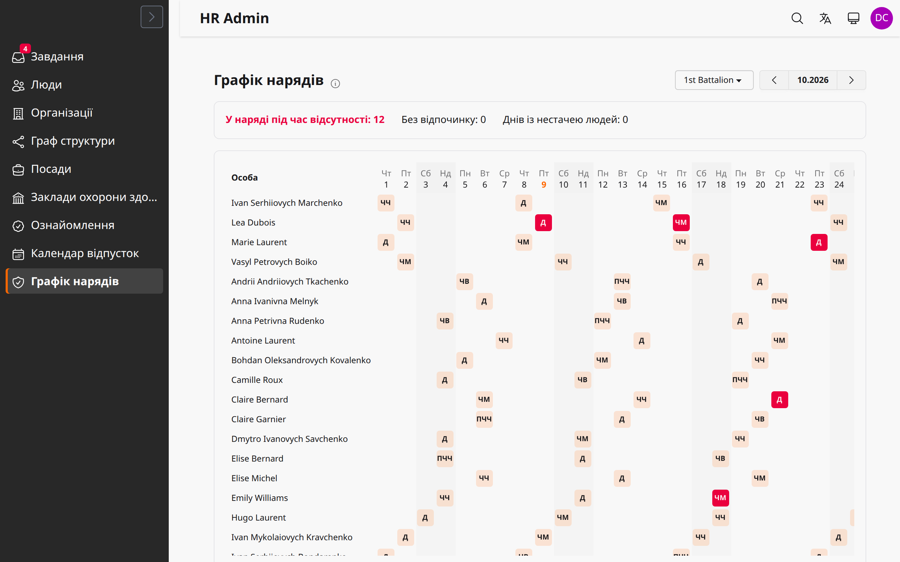

## Граф структури

Розділ **Граф структури** показує підрозділ як схему: підрозділи, посади,
люди, лінії підпорядкування й заступництва (за потреби — заклади охорони
здоров'я та місця). Оберіть підрозділ і вигляд (мережа, ієрархія, кола),
знайдіть людину на графі; клацання по вузлу відкриває подробиці.
Зображення можна зберегти в PNG.

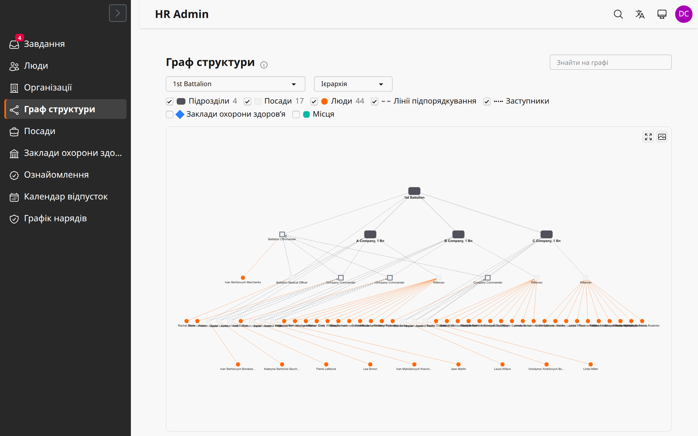

## Ознайомлення списком

Розділ **Ознайомлення** показує підписані накази, з якими люди
підрозділу ще не ознайомлені. Відфільтруйте за підрозділом, наказом чи
датою, позначте людей і натисніть **«Записати для вибраних»** — з датою
та способом (зачитано особі, підписано на папері).

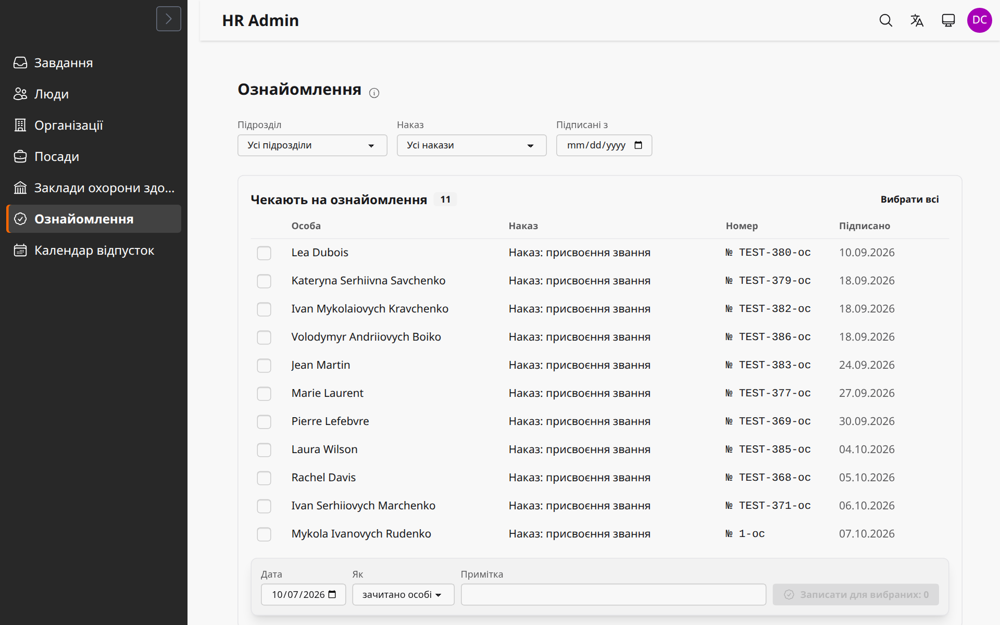

# Кадровий орган: накази та особові справи

## Завдання кадрового органу

На сторінці **Завдання** — документи для погодження й підпису, власні
проєкти та проєкти, які система відкрила для команди. Наприклад, після
підпису рапорту на відпустку автоматично з'являється проєкт **наказу про
відпустку**.

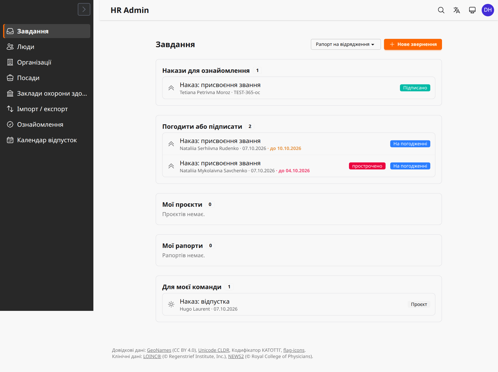

## Наказ на підставі рапорту

Проєкт наказу вже заповнено даними з рапорту, а рапорт указано як
підставу. Кадровий орган перевіряє дані та надсилає наказ за маршрутом:
начальник кадрового органу погоджує, командир підписує. Після підпису
відпустка записується в особову справу.

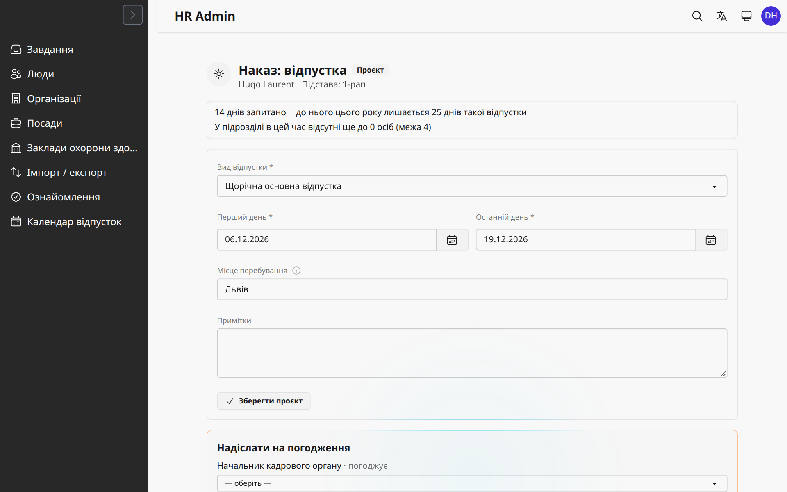

Так само працюють накази про **призначення, переміщення, звільнення,
присвоєння звання** та **відрядження**: посади й записи змінюються лише
підписаними наказами. Підписаний наказ друкується на бланку з
реєстраційною позначкою.

## Люди та особова справа

Розділ **Люди** — список осіб із пошуком і фільтрами. Особова справа
поділена на вкладки: **Призначення** (поточна посада, підпорядкування,
підлеглі, історія), **Ідентифікація** (документи, номери), **Записи**,
**Файли**, **Документи**, **Хронологія**. Значки під іменем показують
придатність, допуск, алергії.

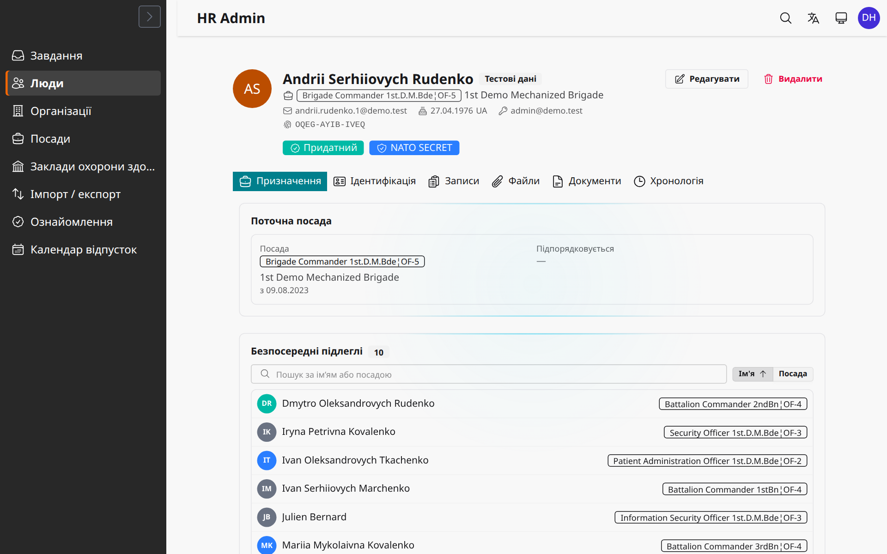

## Імпорт і експорт призначень

Призначення можна вивантажити в Excel або Google Sheets, змінити там і
завантажити назад. Система спершу показує, що зміниться, а потім створює
**проєкти наказів** (призначення, переміщення, звільнення), які
проходять звичайний маршрут.

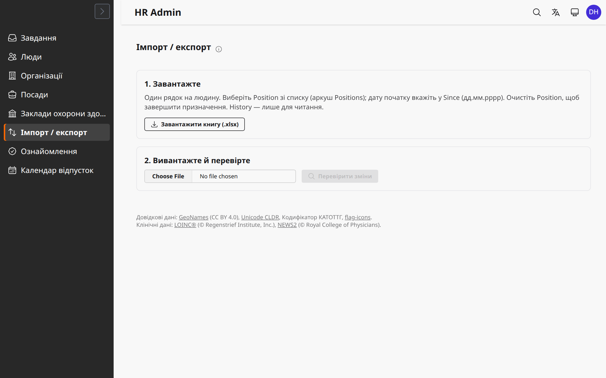

Те саме — і значно більше — можна робити прямо в **Google Sheets**:
вивантажити призначення, особовий склад або записи (звання, контакти,
відпустки…) у вкладку, оформлену як форма застосунку, змінити й
перевірити. Докладно — в окремому посібнику *«Застосунок для Google
Sheets»*.

## Реєстри та номенклатура справ

**Реєстри** — усі зареєстровані документи за видами й роками.
**Номенклатура справ** — справи року, до яких документи підшиваються
автоматично під час підпису; закриту справу можна описати (опис справи в
PDF), а після строку зберігання — оформити акт про знищення.

## Структура

Розділи **Організації** та **Посади** — ієрархія підрозділів і штатні
посади (звання, кому підпорядковується, чисельність).

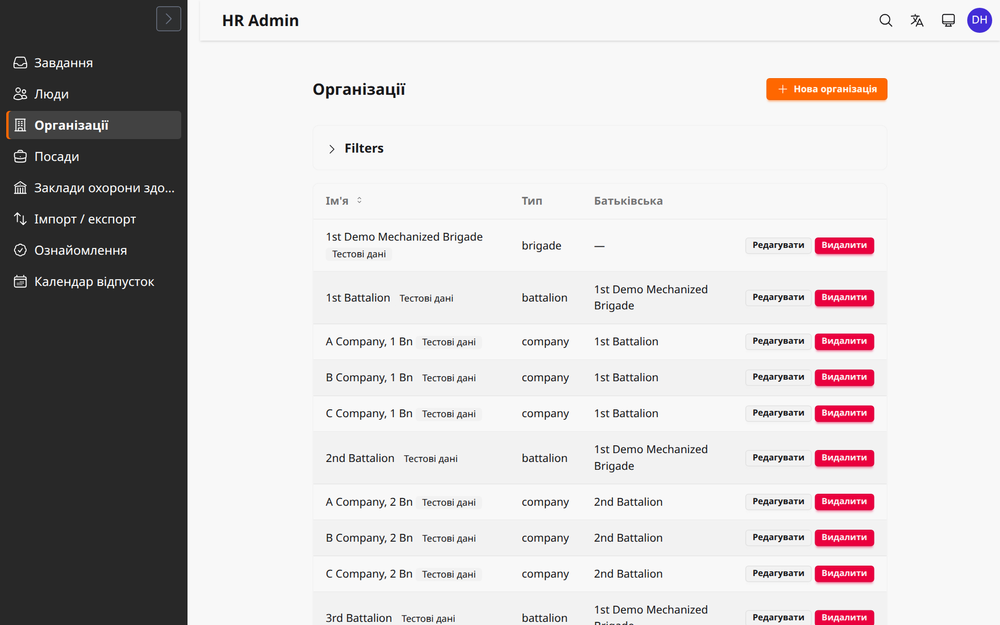

# Медичний персонал

Медичні записи ведуться у вкладці **Записи** особової справи (фільтр
«Медичні»). Життєві показники показуються з динамікою та оцінкою
**NEWS2**; алергії та постійні препарати видно значками під іменем,
щоб їх бачив кожен, хто надає допомогу.

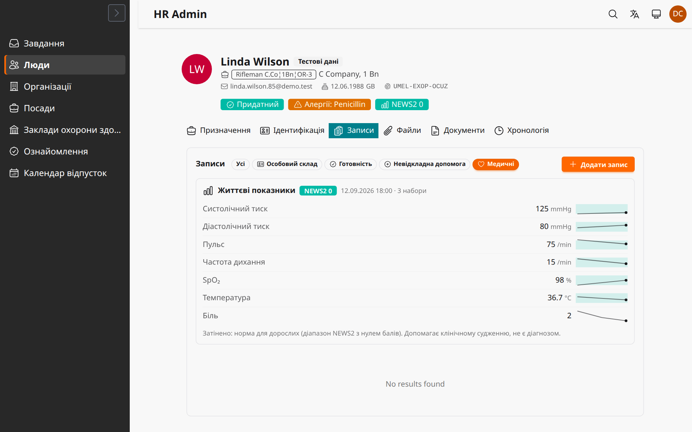

**Результати аналізів** показують значення з одиницею виміру,
референтний діапазон, оцінку (звичайна, підвищена, знижена) і попереднє
значення того самого аналізу — динаміку видно одразу.

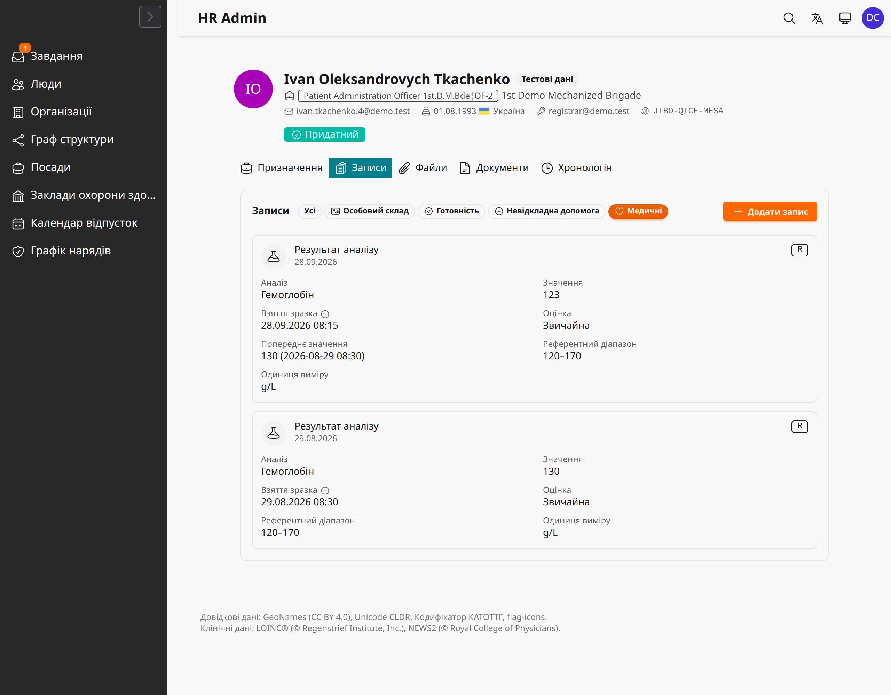

Основні медичні процеси:

| Процес | Як працює |
|---|---|
| **Обстеження й допомога** | Обстеження, показники, введені препарати, процедури; попередження про алергію на препарат і про взаємодію препаратів. |
| **Аналізи** | Результат аналізу з одиницею, діапазоном, оцінкою й попереднім значенням. |
| **Направлення → виписка** | Направлення до закладу охорони здоров'я; виписку підписують лікар і завідувач відділення; лікарняний записується як відсутність без діагнозу. |
| **ВЛК** | Направлення на ВЛК, висновок комісії; після підпису оновлюється придатність, а командир і кадровий орган отримують лише висновок, без діагнозу. Особа ознайомлюється з висновком у застосунку. |
| **Екстрений доступ** | Кнопка «Екстрений доступ» відкриває медичні дані в невідкладній ситуації; кожен такий доступ потім перевіряє служба безпеки. |

# Адміністратор і безпека

## Налаштування системи

**Налаштування** — перевірки узгодженості даних (увімк./вимк.), межа
одночасно відсутніх у підрозділі для календаря відпусток, кількість днів
на погодження чи підпис.

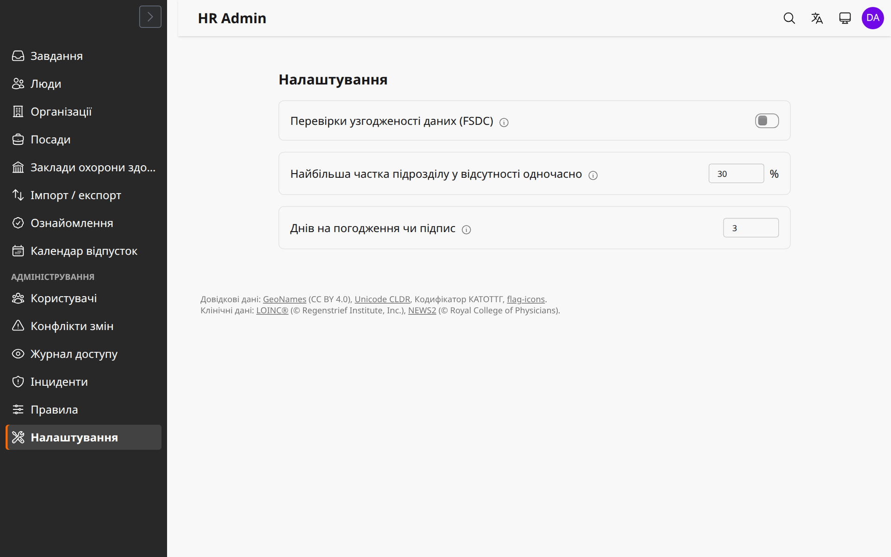

## Інтерфейс користувача

Кожен користувач може налаштувати під себе, як відкриваються форми
(на сторінці чи у вікні — окремо для телефона й широкого екрана), як
показуються кнопки додавання, рамки розділів і вигляд вікон.

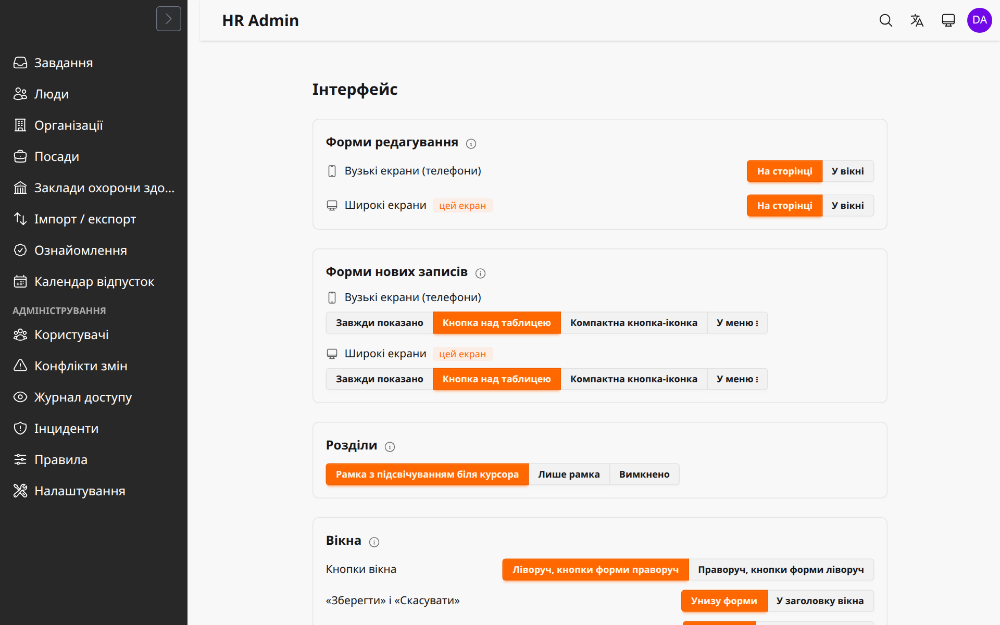

## Користувачі та правила

**Користувачі** — ролі й профілі доступу, прив'язка облікового запису до
особи. **Правила** — перевірки узгодженості даних у візуальному
редакторі; порушення фіксуються в розділі **Інциденти**.

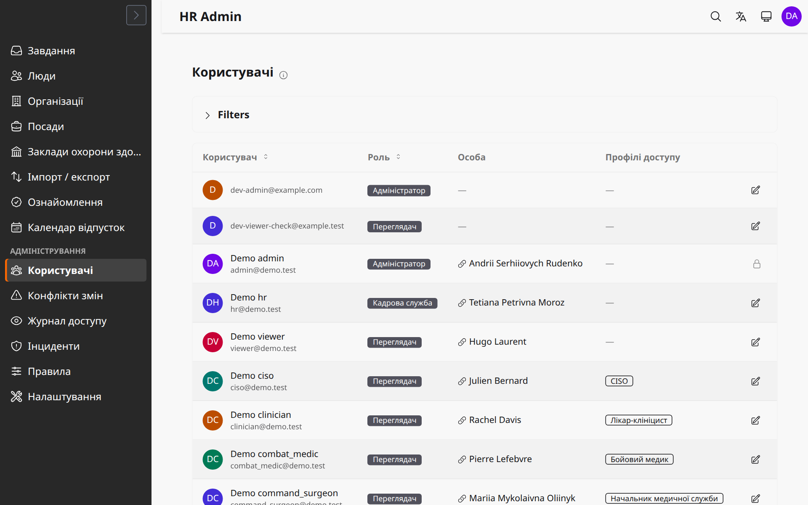

**Вигляд бічної панелі** — що бічна панель Google Sheets показує кожній
ролі та кожному профілю доступу (вкладки, значки інструментів, розділи).

## Журнал доступу

Кожне відкриття чутливих даних (медичних, кадрових, номерів документів)
записується: хто, коли, що і щодо кого. Записи не можна змінити.

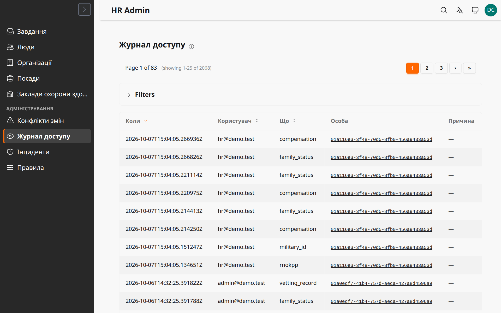

# Короткі поради

- Почніть день зі **стартової сторінки** — там усе, що чекає саме на вас.
- **Пошук** (лупа вгорі) знаходить людей, документи за номером, накази.
- Мова, тема оформлення та обліковий запис — іконки в правому верхньому
  куті.
- Для масових змін (багато людей чи записів одразу) зручніше працювати в
  **Google Sheets** — див. окремий посібник.
- Підказки до полів — у значках **ⓘ** поруч із назвами.
- Підписаний документ змінити не можна: помилку виправляє новий наказ.
